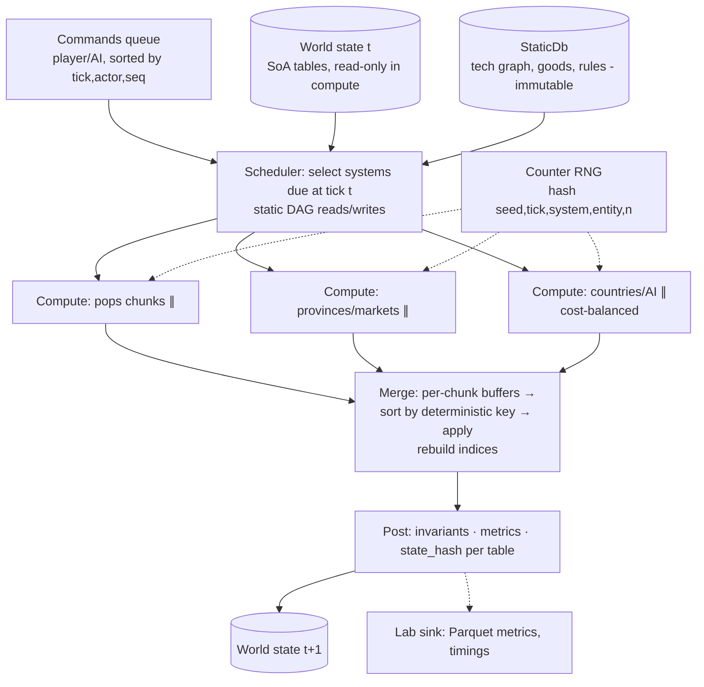

# RR-002 — Архитектура ядра симуляции, многопоточность, детерминизм, Simulation Lab

| Поле | Значение |
|---|---|
| ID | RR-002 |
| Дата | 2026-11-02 |
| Статус | DRAFT |
| Автор | Research agent (Phase B) |
| Связанные | RR-001 (выбор языка, делает отдельный агент) |

Пометки: **[F]** — факт с источником; **[A]** — допущение/оценка агента; **[R]** — рекомендация (PROPOSED, не решение).

---

## 1. Вопрос исследования

Как устроить ядро симуляции глобальной grand strategy (1910–2100, ~100+ стран, ~10^4 провинций, ~10^5 pop-групп), чтобы оно:
- работало headless и независимо от GUI;
- было многопоточным без data races;
- давало воспроизводимый результат по seed (и не закрывало lockstep-мультиплеер);
- поддерживало Simulation Lab: пакетные прогоны, sweep'ы, Monte Carlo, регрессии, бенчмарки;
- было data-driven и пригодным для модов.

## 2. Краткий вывод

1. Классический ECS «как в action-играх» здесь не главный выигрыш: типов сущностей мало (страна, провинция, pop, рынок, технология, армия), связей и графов много. **[R]** Нужно **data-oriented ядро на таблицах (SoA) с плотными целочисленными ID** и явными индексами связей. Полноценный ECS-фреймворк не нужен.
2. **[R]** Такт строится как **фазовый конвейер**: каждая фаза читает снимок предыдущего состояния, вычисляет параллельно по разделам (страны/провинции) и пишет в свой буфер. Затем идёт **детерминированный последовательный merge**: сортировка по ключу и применение команд/событий. Сам такт длится один день, системы работают на нескольких частотах (день, неделя, месяц, год). Victoria 3 делает почти то же самое **[F]**.
3. **[R]** Детерминизм проектируется уровнями. Обязательно с M0: L1 (тот же бинарник и та же машина) и L2 (результат не зависит от числа потоков). Отложено, но не закрыто: L3 (кросс-платформенный, нужен для lockstep). Что для этого нужно: деньги и запасы в **int64 fixed-point**; float только в «мягких» моделях; без FMA-контракции и fast-math; свои реализации трансцендентных функций; **counter-based RNG**, зависящий от `(seed, tick, system, entity, n)`; никакой итерации по hash map.
4. **[R]** Lab — это **параллельный запуск процессов** (один прогон = один процесс), а не потоков. Есть манифест эксперимента (TOML/JSON) с версиями ядра и данных, параметрами и seed. Метрики пишутся в **Parquet**, метаданные в **DuckDB/SQLite**, анализ делается на Python (polars + DuckDB + Jupyter). Регрессии проверяются двумя способами: точным совпадением хеша состояния (golden runs) и статистическим сравнением распределений (KS/квантили) для Monte Carlo.
5. **[A]** Бюджет вполне реалистичен: дневной такт для 10^5 pop-групп укладывается примерно в 5–30 мс на 8 ядрах, если модель pop «агрегатная» (вектор чисел, без поведения агента).

---

## 3. Паттерны архитектуры ядра

### 3.1 Сравнение подходов

| Подход | Плюсы | Минусы для нашей задачи | Вывод |
|---|---|---|---|
| Archetype ECS (Unity DOTS, Bevy tables, Flecs) | Быстрая итерация по однородным наборам компонентов, кэш-локальность **[F]** | Каждое добавление или удаление компонента переносит сущность в другой архетип **[F]**. Связи и графы неудобны: в Flecs relationships встроены в архетипы, что усложняет очистку **[F]** | Избыточно: у нас мало типов сущностей и стабильный набор полей |
| Sparse-set ECS (EnTT, Bevy SparseSet) | Дешёвые add/remove **[F]** | Итерация медленнее, чем у архетипов **[F]** | Можно использовать для редких «тегов» (война, оккупация) |
| SoA-таблицы на тип сущности (data-oriented) | Плотные массивы `Vec<f64>`/`Vec<i64>` по полю. ID — это индекс. Легко сериализовать, сравнивать, делить на чанки | Схему и индексы связей пишем сами | **[R] Основа** |
| Классический OOP (объект `Country` с методами) | Легко понять владельцу | Shared mutable state, гонки, плохая кэш-локальность, трудно параллелить и делать снимки | Не для ядра. Допустим в tooling/GUI |

**[R]** Схема такая: `World { countries: CountryTable, provinces: ProvinceTable, pops: PopTable, markets, techs, relations: RelationTables, ... }`.
- Связи хранятся как **индексные таблицы**, например `province.owner: CountryId` плюс обратный индекс в CSR-формате (`country → [province_ids]`). Обратный индекс пересобирается в фазе merge.
- Граф технологий и граф торговли — CSR/adjacency arrays. Граф технологий не меняется во время прогона и загружается из данных.
- Сущности, которые рождаются и умирают (армии, pop при слиянии и разделении), живут в таблицах с **generational ID** и free-list. Порядок обхода всегда идёт по возрастанию индекса.

### 3.2 Как это делают другие (что удалось подтвердить)

| Игра | Что известно | Тип |
|---|---|---|
| Victoria 3 (Clausewitz/Jomini) | Такт = 6 игровых часов. Задачи такта делятся на yearly/monthly/weekly/daily/regular, у каждой есть частота и зависимости. Отдельный session-поток для симуляции. Пул primary task threads по числу ядер. Secondary threads для сохранений и графики. UI читает состояние только между задачами такта (`CScopedGameStateRelease`). Employment: параллельный pre-step → последовательная часть (создание и удаление pop, скрипты) → **сортировка, чтобы не было OOS в MP**. Modifier nodes с dirty-флагами, пересчёт пакетами по зависимостям. Балансировка нагрузки по эвристической стоимости, крупные страны планируются отдельно. Аллокатор mimalloc дал около 4% | [F] DD#76 |
| Victoria 3 1.7 | Главный прирост производительности дала переделка модификаторов; кэширование и многопоточность расширены | [F] DD#123 |
| Paradox (EU4/HOI4/Stellaris → CK3) | Доклад M. Ropert (ACCU 2023): три модели многопоточности, старая (EU4/HOI4/Stellaris) и новая с CK3 | [F] (детали только в видео) |
| Factorio | Deterministic lockstep MP. При desync клиент перекачивает сейв и формирует отчёт. Есть «heavy mode» (save/load каждый тик) для поиска расхождений | [F] wiki |
| Factorio | FFF#215: параллельная версия части апдейта оказалась **медленнее** из-за false sharing и кэш-инвалидации, потому что раскладкой памяти не управляли | [F] |
| Factorio | FFF#415: desync зависел от **числа ядер** (генерация чанков). Вывод разработчика: «детерминированная многопоточность ещё сложнее» | [F] |
| Dwarf Fortress | Экспериментальная многопоточность появилась в 50.09 (2023, Putnam). По неофициальным данным, сначала только line-of-sight | [F]/[A] |
| RimWorld | Однопоточная симуляция, у объектов разные частоты тика (Normal/Rare/Long) | [A], официальный источник не найден |
| Songs of Syx | Надёжных технических источников не найдено | — |

**Вывод [A]:** ближайший аналог — Victoria 3. Нам подходит её модель «граф задач такта с частотами + параллельные шаги + последовательные шаги с сортировкой». Уроки Factorio: (а) раскладка памяти важнее числа потоков; (б) результат не должен зависеть от числа ядер, и это нужно тестировать с первого дня.

---

## 4. Модель такта

### 4.1 Основные принципы [R]

- **Fixed time step:** 1 такт = 1 день. Время — целое `tick: u32/u64`, без float. Календарь выводится из tick.
- **Multi-rate:** у каждой системы есть `period` (1, 7, ~30 по календарю, 365) и `phase offset`.
  - Чтобы месячные системы не создавали пик каждые 30 дней, дорогую месячную работу **размазывают**: страна `i` обновляется в день `i mod 30`. Это детерминированно, потому что зависит только от ID.
  - Минус: модели становятся несимметричными. Это решение для ADR.
- **Фазовый конвейер (read-old / write-new):**
  1. `Input`: команды игрока и ИИ из прошлого такта, отсортированные по `(tick, actor_id, seq)`.
  2. `Compute` (параллельно): системы читают **неизменяемый** `&World`. Каждая пишет либо в свои колонки (владение колонкой = отсутствие гонок), либо в **буферы команд/событий**, по одному на рабочий чанк.
  3. `Merge` (последовательно или параллельно по непересекающимся ключам): буферы сливаются, **сортируются по детерминированному ключу** и применяются. Затем пересобираются индексы.
  4. `Post`: инварианты (в debug и Lab), метрики, хеш состояния (выборочно).
- **Double buffering:** полностью копировать мир не нужно. Достаточно двойных буферов для полей, которые читаются соседями в том же такте (цены, запасы на рынке). Остальное обновляется на месте, если поле «принадлежит» одной системе и одному разделу.

### 4.2 Безопасный параллелизм

| Приём | Где | Комментарий |
|---|---|---|
| Partition by owner (страна) | бюджет, ИИ, политика | Неравномерность огромная (Victoria 3: до 100×) **[F]**. Нужны чанки по стоимости и отдельная обработка выбросов |
| Data-parallel по pop/провинциям | спрос, производство, демография | Чанки фиксированного размера, например 1024 pop |
| Межстрановые взаимодействия (торговля, война) | через события | Пишутся в буфер, применяются в merge. Прямой записи в чужую страну нет |
| Рынки | двухфазно | Фаза 1: каждый агент публикует заявки. Фаза 2: клиринг рынка (параллельно по рынкам). Фаза 3: исполнение |
| Граф задач такта | планировщик | Статический DAG систем с декларацией `reads`/`writes`. Корректность проверяется при запуске |

**Job system / work stealing:** Rust — `rayon`. C# — `Parallel.For`/TPL или свой пул. C++ — TBB / enkiTS / taskflow. **[R]** Work stealing допустим **только если результат не зависит от того, какой поток выполнил чанк**. Отсюда правила:
- результат чанка зависит только от входа чанка;
- reduction выполняется в фиксированном порядке чанков, а не в порядке завершения;
- RNG не берётся из thread-local.

### 4.3 Очереди событий

**[R]** Отложенные события («через 30 дней начнётся кризис») хранятся в priority queue по ключу `(fire_tick, event_type, entity_id, seq)`. Ключ полностью упорядочен, ties исключены. Ad-hoc очереди с порядком вставки из разных потоков запрещены.

---

## 5. Детерминизм

### 5.1 Уровни детерминизма [R]

| Уровень | Гарантия | Зачем | Когда |
|---|---|---|---|
| L0 | Повторяемость в одном процессе | отладка | всегда |
| L1 | Тот же бинарник + та же ОС/CPU → бит-в-бит | Lab, golden runs, баг-репорты | M0 |
| L2 | L1 при любом числе потоков | Lab на разных машинах, корректность параллелизма | M0 |
| L3 | Бит-в-бит между ОС/компиляторами/CPU (x64 и ARM64) | lockstep MP, обмен реплеями | не закрывать. Включать позже |

### 5.2 Источники расхождений float

| Источник | Суть | Язык |
|---|---|---|
| Базовые операции IEEE 754 (+ − × ÷ sqrt) | Корректно округлены, при одинаковом порядке операций одинаковы на SSE2/AArch64 **[F]** | все |
| FMA-контракция | `a*b+c` с одним округлением вместо двух даёт другой результат **[F]** | C++: GCC в GNU-режиме по умолчанию `-ffp-contract=fast`, Clang — `on` [A, проверить]. Нужен `-ffp-contract=off`. MSVC — `/fp:precise`, проверить `/fp:contract`. Rust: автоматической контракции нет, `mul_add` явный [A, высокая уверенность]. .NET: RyuJIT, по нашим данным, сам не сливает, `Math.FusedMultiplyAdd` явный [A, подтверждения в документации не найдено] |
| x87 80-bit | Расширенная точность промежуточных значений **[F]** (Gaffer) | Не использовать 32-bit x86. Только x64/ARM64 |
| fast-math / `-Ofast` / reassociation | Компилятор переставляет операции | C++: запретить. Rust по умолчанию не делает. Burst в Unity имеет отдельный deterministic mode **[F]** |
| Трансцендентные (sin, exp, ln, pow) | Берутся из платформенной libm (glibc/MSVC CRT/macOS) и **различаются в последнем ulp** **[F]** | Все. В .NET `Math.Sin` вызывает CRT, на x86 исторически были интринсики **[F]** coreclr#7023. **[R]** Свои реализации (полиномы фиксированного порядка) или чистый crate/библиотека. Запрет на линтере (clippy `disallowed-methods`, Roslyn analyzer) **[F]** |
| SIMD/автовекторизация | Порядок горизонтальных сумм меняется в зависимости от ширины вектора | Reduction писать явно, с фиксированным порядком |
| Параллельные reduction | `sum` по чанкам в порядке завершения недетерминирован | Фиксированное дерево чанков. Для денег — int64 |
| Debug vs Release | Разные оптимизации | Golden-тесты только на Release-профиле |

Gaffer on Games: детерминизм float реален «на одном компиляторе и одном наборе инструкций», а кросс-платформенный ожидать «наивно» **[F]**. Gas Powered Games при этом сообщали о работающем на IEEE float RTS-lockstep **[F]** (HN, оценка единичная). Значит, L3 на float возможен, но требует дисциплины.

### 5.3 Fixed-point vs float [R]

| Величина | Тип | Почему |
|---|---|---|
| Деньги, запасы товаров, население (головы) | `i64` fixed-point (например, 1 ед. = 10^-4) | Сохранение массы и денег проверяется точно (`==`), детерминизм бесплатный |
| Цены, коэффициенты, доли, вероятности | `f64` с дисциплиной L3 **или** `i64` Q32.32 | Fixed-point для нелинейных моделей неудобен: нужно следить за переполнением, своё `exp`/`ln`. **[A]** Он примерно в 1,5–3 раза медленнее в сложной математике, зато быстрее в простой арифметике |
| Прогресс исследований | `i64`/`u32` | Монотонная величина, достаточно целых |
| Вывод/аналитика | `f64` | Не влияет на состояние |

**[R]** Гибрид: «бухгалтерия» хранится в целых, «поведенческие модели» считаются в f64 с правилами L3. Все конверсии f64→i64 проходят через одну функцию с явным округлением (`round_half_even`).

### 5.4 RNG

**[R]** Используем **counter-based / stateless** RNG: `u = hash(seed, tick, system_id, entity_id, draw_idx)`.
- Подходят SplitMix64-финализатор (быстро, достаточно для игровой логики) или Philox4x32-10 (Random123, SC11, без состояния, хорош для параллелизма **[F]**). Есть в numpy (`Philox`) **[F]**, что упрощает кросс-проверку из Python.
- Результат не зависит от потоков и порядка обхода. Добавление новой системы не «сдвигает» случайность в других системах, потому что `system_id` стабилен. Это важно для A/B-сравнений в Lab.
- PCG или xoshiro с состоянием допустимы только как per-entity стримы, засеянные из того же хеша.
- Запрещены: глобальный RNG, thread-local RNG, время или адреса как seed.
- Функции «вероятностного выбора из распределения» фиксируются в ядре и не берутся из стандартной библиотеки. `rand::distributions`, `System.Random` и `<random>` могут меняться между версиями. В C++ `std::uniform_real_distribution` вообще не специфицирован побитово [A].

### 5.5 Порядок итерации

- Rust `HashMap` по умолчанию: SipHash со случайным ключом, поэтому порядок **меняется от запуска к запуску** [A, документировано в std].
- C# `Dictionary`: порядок не гарантирован, а после удалений и вставок отличается от порядка вставки.
- C++ `unordered_map`: порядок зависит от реализации.
- **[R]** В состоянии мира разрешены: плотные массивы по ID, `BTreeMap`/`SortedDictionary`, `IndexMap` с детерминированным хешем. Hash map без итерации допустим как lookup.

### 5.6 Lockstep vs state sync

| | Lockstep | State sync / server-authoritative |
|---|---|---|
| Трафик | только команды | дельты состояния: при 10^5 pop большие |
| Требование | L3 детерминизм | достаточно L1 на сервере |
| Desync | надо ловить хешем состояния каждые N тиков (Factorio) **[F]** | нет |
| Пример | Factorio, Paradox (OOS-ошибки, сортировка в V3) **[F]** | — |

**[R]** Ничего не выбирать сейчас, но ядро уже должно иметь: (а) команды как единственный вход; (б) `state_hash()` по каналам (по таблицам); (в) уровень L2. Тогда lockstep потом сведётся к работе над L3.

---

## 6. Сохранения и снапшоты

- **[R]** Состояние = таблицы SoA. Сериализация идёт по колонкам: бинарный формат с заголовком `{format_version, core_version, data_version, tick, seed, rng_counter_state}` и сжатием zstd.
  - Кандидаты: свой columnar-формат, FlatBuffers/Cap'n Proto для заголовков, bincode/MessagePack.
  - Сериализовать колонки в Arrow IPC удобно для Lab: снапшот можно открыть в polars или DuckDB напрямую [A].
- **Версионирование схемы:** у каждой таблицы есть `schema_version`. Миграции пишутся как цепочка функций `vN → vN+1`. Старые сейвы как регрессионные фикстуры.
- **Инвариант round-trip:** `hash(load(save(W))) == hash(W)`, и `run(load(save(W)), k)` даёт тот же хеш, что `run(W, k)`. Это аналог «heavy mode» Factorio **[F]**. Тест входит в CI.
- **Хеш состояния:** xxHash3/BLAKE3 по каналам, то есть отдельный хеш на таблицу. При расхождении сразу видно, какая таблица разошлась.
- **Для Lab:** снапшот на тике T позволяет запустить веер сценариев с одной точки (branching) без повторного прогона с 1910 года.

---

## 7. Simulation Lab

### 7.1 Запуск

| Вариант | Плюсы | Минусы |
|---|---|---|
| Процесс на прогон | Изоляция падений, нет общего состояния, простая параллельность на N ядер или машин, легко назначить таймаут | Накладные расходы на старт и загрузку данных: [A] доли секунды, несущественно |
| Потоки в одном процессе | Общая загрузка данных | Ядро и так многопоточное, будет конкуренция пулов. Падение одного прогона роняет все |

**[R]** Оркестратор (Python или CLI ядра) запускает `sim run --manifest m.toml --run-id k`. Число одновременных процессов ≈ ядра / потоки_на_прогон. Для Monte Carlo — 1 поток на прогон и N процессов: так эффективнее, чем один прогон на много потоков. Для бенчмарка — один процесс на все ядра.

### 7.2 Манифест эксперимента (пример) [R]

```toml
[experiment]
id = "EXP-0042"; hypothesis = "налог 20% снижает рост ВВП < 5%"
[versions]
core = "git:abc1234"; data = "sha256:..."; manifest_schema = 1
[scenario]
start = "1910-01-01"; end = "1960-01-01"; snapshot_from = ""   # опц. ветвление
[params]                      # базовые
"economy.tax_rate" = 0.15
[sweep]                       # декартово произведение или список
"economy.tax_rate" = [0.10, 0.15, 0.20]
[monte_carlo]
seeds = { base = 12345, count = 50 }   # seed_k = splitmix(base, k)
[metrics]
every = "month"; set = ["gdp_by_country", "pop_total", "tech_count", "money_supply"]
[determinism]
threads = 1; check_hash_every = "year"
```

На каждый прогон записывается `run.json`: финальный манифест, хост, CPU, ОС, флаги сборки, длительность, хеши состояния, exit code.

### 7.3 Хранилище и анализ

| Формат | Использование |
|---|---|
| **Parquet** (по файлу на прогон или партиции `exp/run/`) | Временные ряды метрик: колонки `run_id, tick, entity, metric, value` или «широкие» таблицы на семейство метрик |
| **DuckDB** (один файл каталога) | Реестр экспериментов и прогонов. SQL поверх Parquet без загрузки |
| SQLite | Альтернатива каталогу, если DuckDB не нужен |
| CSV | Только экспорт и мелкие отладочные дампы |

Стек анализа: Python + **polars** + **DuckDB** + Jupyter/marimo, графики через matplotlib/plotly. **[R]** Ядро пишет Parquet через Arrow-библиотеку своего языка: Rust — `arrow`/`parquet` crates, C# — Parquet.Net / ParquetSharp, C++ — Apache Arrow C++. Python в горячем пути не участвует.

### 7.4 Регрессии

- **Golden runs (детерминированные):** фиксированные сценарии × seed. В CI сравниваются по каналам хешей состояния на контрольных тиках. Любое изменение хеша требует явного «rebaseline» с пометкой в changelog.
- **Статистические (поведенческие):** после изменения модели хеши неизбежно меняются. Тогда N=30–100 seed'ов старой и новой версии сравниваются по распределениям ключевых метрик:
  - KS / Anderson–Darling;
  - квантили (p5/p50/p95);
  - bootstrap-доверительный интервал разницы;
  - для многих метрик — поправка на множественные сравнения (Benjamini–Hochberg).
- Отчёт строится автоматически: таблица «метрика → эффект → p → флаг».
- **Бенчмарки:**
  - время каждой фазы и системы за такт (p50/p95/max) пишется в тот же Parquet;
  - на фиксированном сценарии и железе сравнивается с предыдущей версией, порог регрессии примерно 5–10%;
  - отдельно отслеживаются аллокации и пиковая память.

---

## 8. Стратегия тестирования

| Уровень | Что | Инструменты (Rust / C# / C++) |
|---|---|---|
| Unit | Чистые функции моделей (клиринг рынка, демография) | built-in / xUnit / Catch2/GoogleTest |
| Property-based | «Клиринг не создаёт деньги», «сумма долей = 1», монотонность, устойчивость к перестановке входа | proptest / FsCheck / RapidCheck |
| Инварианты в рантайме | Сохранение денег (эмиссия и уничтожение только через явные каналы), неотрицательность запасов, сумма pop = сумма по провинциям, ссылочная целостность ID | Включены в debug и Lab, выключаются флагом |
| Determinism tests | Прогон с 1/2/8/N потоками даёт одинаковый хеш (L2). Save→load→run даёт тот же хеш. Перестановка порядка входных команд в пределах ключа ничего не меняет | CI-матрица |
| Golden/snapshot | Хеши и выборочные метрики эталонных сценариев | insta / Verify / ApprovalTests |
| Fuzzing сценариев | Случайные параметры и моды в допустимых диапазонах на 10–50 лет. Проверка: нет паники, NaN/Inf, нарушений инвариантов. Минимизация падающего seed | cargo-fuzz/proptest / SharpFuzz / libFuzzer |
| Кросс-платформенные (позже, L3) | Один сценарий на Win/Linux/macOS и x64/ARM64 → сравнение хешей по каналам | CI на 3 ОС |

**[R]** NaN-guard: проверка `is_finite` всех f64-колонок раз в такт в debug. NaN в экономике — самая частая «тихая» ошибка.

---

## 9. Бюджет производительности [A]

Допущения: pop-группа — агрегат (≈ 20–50 полей), без индивидуального поведения. ИИ стран принимает решения раз в неделю или месяц. Машина — 8 ядер, около 2026 года.

| Система | Объём | Частота | Стоимость/ед. | Дневная нагрузка (1 поток) |
|---|---|---|---|---|
| Pop: потребление/доход/занятость | 10^5 | день | 0,2–1 µs | 20–100 мс |
| Провинции: производство | 10^4 | день | 1–5 µs | 10–50 мс |
| Рынки: клиринг (~10^2–10^3 рынков × ~50 товаров) | 10^4–10^5 пар | день | 0,1–0,5 µs | 1–25 мс |
| Демография pop | 10^5 | месяц | 1–3 µs | 3–10 мс/день (размазано) |
| Наука (граф ~10^3–10^4 узлов × 10^2 стран) | 10^5–10^6 | неделя/месяц | 0,05–0,2 µs | ≤5 мс/день |
| ИИ стран | 10^2 | неделя | 0,1–2 мс | 1,5–30 мс/день |
| Merge/индексы/метрики | — | день | — | 2–10 мс |

Итого: около 40–230 мс на день в 1 потоке. При 8 ядрах и эффективности параллелизма около 60–70% получается **≈ 8–45 мс на день**.
- 190 лет ≈ 69 000 дней, то есть **≈ 10–50 минут на полный прогон 1910–2100 на 8 ядрах** или примерно 45–260 минут в 1 потоке.
- Для Monte Carlo в 1 поток на прогон: 8 прогонов параллельно дают **~2–4 полных прогона в час** на машину.

**[R]**
- Для Lab важна дешёвая «укороченная» модель: меньше стран, горизонт 20–50 лет. Именно такой будет M0 (несколько стран, ~10^3 pop): там миллисекунды на такт и тысячи прогонов в час.
- Цель для игры: ≤ 50 мс на день на «максимальной скорости», что даёт год примерно за 18 с.
- Главные рычаги: pop merging (как в V3 **[F]**), dirty-флаги и кэши модификаторов (V3 **[F]**), SoA-раскладка, отсутствие аллокаций в горячем цикле, профилирование по фазам с первого дня.

---

## 10. Рекомендуемая архитектура ядра (PROPOSED)

Слои:
- `sim-core` — чистая библиотека без I/O и GUI: World, системы, планировщик.
- `sim-data` — загрузка и валидация модов и данных в неизменяемый `StaticDb`.
- `sim-cli` — headless runner.
- `lab` — оркестратор и анализ на Python.
- `gui` — будущий отдельный клиент. Читает снапшот или копию «view-state» между тактами, как UI в V3 **[F]**, и шлёт только команды.



Ключевые правила:
- нет глобального изменяемого состояния;
- система объявляет `reads`/`writes` колонок;
- запись идёт только в свои колонки или в буферы;
- весь ввод — это команды;
- RNG без состояния;
- деньги и запасы в i64.

---

## 11. Решения для ранних ADR

1. **ADR: Модель данных ядра — SoA-таблицы с плотными ID (без ECS-фреймворка)**
2. **ADR: Модель такта — 1 день, multi-rate системы, фазы compute/merge/post, правило «read-old/write-own»**
3. **ADR: Уровни детерминизма L1/L2 обязательны с M0, L3 — не закрывать**
4. **ADR: Числовая политика — i64 fixed-point для денег, запасов и населения; правила для f64 (без FMA-контракции и fast-math, свои трансцендентные функции)**
5. **ADR: RNG — counter-based, ключ `(seed, tick, system_id, entity_id, n)`, конкретный алгоритм (SplitMix64 vs Philox)**
6. **ADR: Запрет недетерминированных коллекций в состоянии мира + линтер-правила**
7. **ADR: Ввод только через команды; GUI — отдельный клиент**
8. **ADR: Формат сейва/снапшота и версионирование схем + хеш по таблицам**
9. **ADR: Формат манифеста эксперимента и хранилище Lab (Parquet + DuckDB)**
10. **ADR: Политика регрессий — golden hash + статистическое сравнение, процедура rebaseline**
11. **ADR: Lab-параллелизм — процесс на прогон**

---

## 12. Риски

| Риск | Вероятность | Влияние | Митигирование |
|---|---|---|---|
| Детерминизм «тихо» ломается (hash map, float reduction, thread-local RNG) | высокая | высокое: Lab теряет ценность | Тест «1 vs N потоков» в CI с M0, линтеры |
| Стоимость L3 недооценена (свой libm, кросс-CI) | средняя | высокое для MP | L3 только по решению, f64-код изолирован в моделях |
| Fixed-point усложняет модели (переполнения, масштабы) | средняя | среднее | Только для бухгалтерии. Checked-арифметика в debug |
| False sharing и плохая раскладка дают «параллельно медленнее» (Factorio FFF#215 **[F]**) | средняя | среднее | SoA, чанки ≥ кэш-линии, бенчмарки по фазам |
| Неравномерность нагрузки по странам (100× **[F]**) | высокая | среднее | Балансировка по стоимости, дробление крупных стран на провинции |
| Экспоненциальный рост pop-групп со временем | средняя | высокое | Pop merging, лимиты, метрика «число pop» в Lab |
| Модели нестабильны (NaN, взрыв цен), и ИИ-код это маскирует | высокая | высокое | Инварианты, NaN-guard, fuzzing, графики Lab |
| Владелец без gamedev-опыта не видит ошибок ИИ-кода в параллелизме | высокая | высокое | Архитектура «гонки невозможны по конструкции» (владение колонками). Язык с проверкой гонок (Rust) снижает риск — см. RR-001 |
| Rebaseline golden-хешей становится рутиной, и регрессии пропускают | средняя | среднее | Статистический отчёт обязателен при rebaseline |

## 13. Открытые вопросы для владельца

1. Нужен ли **мультиплеер** вообще, и если да, то lockstep или сервер? От этого зависит, обязательно ли L3.
2. Насколько детальны pop-группы: агрегатные векторы или с поведением? Это множитель ×10–×100 к бюджету.
3. Длительность такта: подходит ли 1 день, или экономике и науке достаточно недели (это ×7 к скорости)?
4. Допустимо ли, что сейвы между версиями ядра не всегда совместимы (на этапе прототипа)?
5. Где будут идти прогоны Lab: только локальная машина (сколько ядер?) или облако/второй ПК?
6. Устраивает ли Python как язык анализа Lab (notebooks), или нужен UI-дашборд?
7. Нужно ли воспроизведение между Windows/Linux/macOS уже для Lab (обмен результатами), или достаточно одной ОС?

## 14. Источники

Все даты доступа: 2026-11-02.

1. Victoria 3 — Dev Diary #76: Performance — https://www.paradoxinteractive.com/games/victoria-3/news/dev-diary-76-performance
2. Victoria 3 — Dev Diary #76 (форум) — https://admin-forum.paradoxplaza.com/forum/developer-diary/victoria-3-dev-diary-76-performance.1570277
3. Victoria 3 — Dev Diary #123: Sphere of Influence post-release thoughts — https://admin-forum.paradoxplaza.com/forum/developer-diary/victoria-3-dev-diary-123-sphere-of-influence-post-release-thoughts.1691824/post-29730513
4. M. Ropert, «Multi Threading Model in Paradox Games: Past, Present and Future», ACCU 2023 — https://accu.org/video/spring-2023-day-3/ropert ; https://accuconference.org/en/accu2023/public/events/137
5. Factorio Friday Facts #215 — Multithreading issues — https://factorio.com/blog/post/fff-215
6. Factorio Friday Facts #415 — Fix, Improve, Optimize — https://direct.factorio.com/blog/post/fff-415
7. Factorio Friday Facts #188 — Bug, Bug, Desync — https://cf-www.factorio.com/blog/post/fff-188
8. Factorio Wiki — Desynchronization — https://wiki.factorio.com/Desynchronization
9. Dwarf Fortress Wiki — Version history (50.09, 53.11) — https://www.dwarffortresswiki.org/index.php/Version_history
10. Release notes 50.09 (пересказ) — https://ui.lemm.ee/post/510166
11. G. Fiedler, «Floating Point Determinism» — https://gafferongames.com/post/floating_point_determinism
12. Hacker News, обсуждение детерминизма float (Gas Powered Games) — https://news.ycombinator.com/item?id=6006625
13. dotnet/coreclr PR #7023 — Stop treating sine/cosine/round as target intrinsics on x86 — https://github.com/dotnet/coreclr/pull/7023
14. Unity Burst — Float precision determinism — https://docs.unity.com/ja-jp/engine/6000.6/manual/programming-environment/script-compilation/burst/compilation/float-precision-determinism
15. alice-det-math (Rust crate, пример детерминированной математики и clippy disallowed-methods) — https://docs.rs/alice-det-math
16. Salmon et al., «Parallel Random Numbers: As Easy as 1, 2, 3» (SC11) — https://users.cs.utah.edu/~hari/teaching/bigdata/random123sc11.pdf
17. Random123 library — https://github.com/DEShawResearch/random123
18. NumPy — Philox bit generator — https://numpy.org/devdocs/reference/random/bit_generators/philox.html
19. Wikipedia — Counter-based random number generator — https://en.wikipedia.org/wiki/Counter-based_random_number_generator
20. bevy_ecs docs (tables vs sparse sets) — https://docs.rs/bevy_ecs
21. Bevy Archetypes (Tainted Coders) — https://taintedcoders.com/bevy/archetypes
22. «Archetypal ECS Considered Harmful?» (Moonside Games) — https://moonside.games/posts/archetypal-ecs-considered-harmful/
23. Habr — ECS archetype vs sparse set — https://habr.com/en/articles/651921/

Не подтверждено источниками (помечено [A]): детали RimWorld TickerType, Songs of Syx, поведение FMA по умолчанию в GCC/Clang/MSVC/RyuJIT, все цифры бюджета производительности. Перед фиксацией ADR №4 нужна проверка документации компиляторов.
